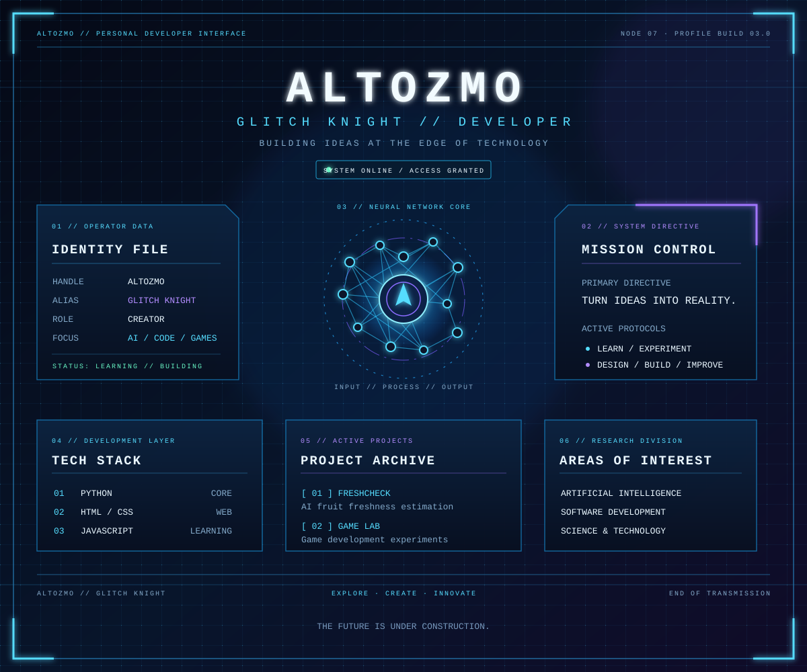

**GLITCH KNIGHT // DEVELOPER & CREATOR**

`PYTHON` · `ARTIFICIAL INTELLIGENCE` · `GAME DEVELOPMENT`

---
<h2 align="center">⚡ TECH ARSENAL</h2>

### `// CURRENT TRANSMISSION`

I'm learning, experimenting, and building projects at the intersection of code and creativity.

- Exploring Python and software development.
- Experimenting with artificial intelligence.
- Building creative projects and games.

### `// PROJECT CHANNELS`

| PROJECT | DESCRIPTION |
|:--|:--|
| **FreshCheck** | AI-based fruit freshness estimation |
| **Game Lab** | Game development experiments |
| **AI Experiments** | Exploring practical AI concepts |

---

`EXPLORE // CREATE // INNOVATE`

**END OF TRANSMISSION — ALTOZMO**

